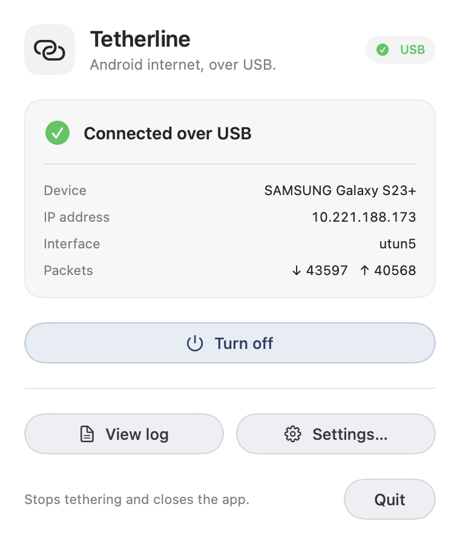

<p align="center">
  
</p>

<h1 align="center">Tetherline</h1>

<p align="center">
  Android USB tethering for macOS, from the menu bar.<br>
  <a href="https://github.com/n3o2k7i8ch5/tetherline/releases/latest"><b>Download the latest release</b></a>
</p>

<p align="center">
  <picture>
    <source media="(prefers-color-scheme: dark)" srcset="docs/images/menu-dark.png">
    
  </picture>
</p>

macOS does not support Android USB tethering out of the box. Tetherline gives your Mac the phone's internet connection over a USB cable, with no kernel extensions or drivers. It runs [muta](https://github.com/jost-s/macos-usb-tether-android), an open-source tethering engine, as a background service and adds a menu bar app to control it.

## Features

- Turn tethering on and off from the menu bar, and see the device, IP address, interface and packet counts.
- The administrator password is needed once, at installation. Turning tethering on and off afterwards needs none.
- Tethering comes back after a restart only if you left it on.
- Warns when traffic may still go through Wi-Fi or a VPN, and when another muta installation is running.
- Optional launch at login. The menu bar and Dock icons can each be hidden.
- English and Polish.

## Requirements

- macOS 14 Sonoma or later, on Apple Silicon or Intel.
- An Android phone with USB tethering, and a USB data cable.

## Installation

1. Download `Tetherline-X.Y.Z.dmg` from the [latest release](https://github.com/n3o2k7i8ch5/tetherline/releases/latest), open it and drag Tetherline to Applications.
2. Open Tetherline. The app is not signed with an Apple Developer ID, so macOS blocks the first launch. Click **Done**, then go to **System Settings → Privacy & Security** and click **Open Anyway**.
3. In the menu bar, choose **Enable tethering** and enter your administrator password.
4. Connect the phone and turn on **USB tethering** in Android's settings.

To uninstall, choose **Settings → Uninstall…**, which removes the background service, its files and logs. Then move Tetherline to the Trash.

## How it works

Enabling tethering for the first time installs two components to `/Library/Application Support/Tetherline`, both owned by root:

- a copy of muta;
- a small helper.

Each runs as a LaunchDaemon. The helper is started by launchd on demand, accepts only *start* and *stop* from the account that installed it, and exits when idle. That is why turning tethering on and off needs no password.

The app checks the SHA-256 and code signature of every component before installing it. After an update, it asks for the password only if the engine or the helper changed. The app reads the connection state from launchd and `muta status` without root privileges.

More documentation, in Polish:

- [docs/DESIGN.md](docs/DESIGN.md): behaviour and security model.
- [docs/BRIEF.md](docs/BRIEF.md): the original brief.
- [docs/VALIDATION.md](docs/VALIDATION.md): test results.

## Building from source

You need Xcode with its command line tools and Python 3. No Apple account or certificate is required.

```sh
make test     # unit, packaging and app model tests
make build    # build/Tetherline.app, ad-hoc signed
make install  # first copy to /Applications
```

The build downloads the muta release pinned in `Vendor/muta.version` and verifies its SHA-256. To move to another muta release, run `scripts/bump-muta.sh vX.Y.Z`.

## Releasing

1. Bump `CFBundleShortVersionString` and `CFBundleVersion` in `Resources/Info.plist`.
2. Describe the release in `docs/RELEASE_NOTES.md`.
3. Push a matching tag:

```sh
git tag vX.Y.Z && git push origin vX.Y.Z
```

GitHub Actions then runs the tests, builds the universal app and publishes `Tetherline-X.Y.Z.dmg` with its SHA-256. `scripts/package-release.sh` builds the same image locally.

## Credits

Tetherline bundles [muta](https://github.com/jost-s/macos-usb-tether-android) by Jost Schulte (MIT License), unmodified.
